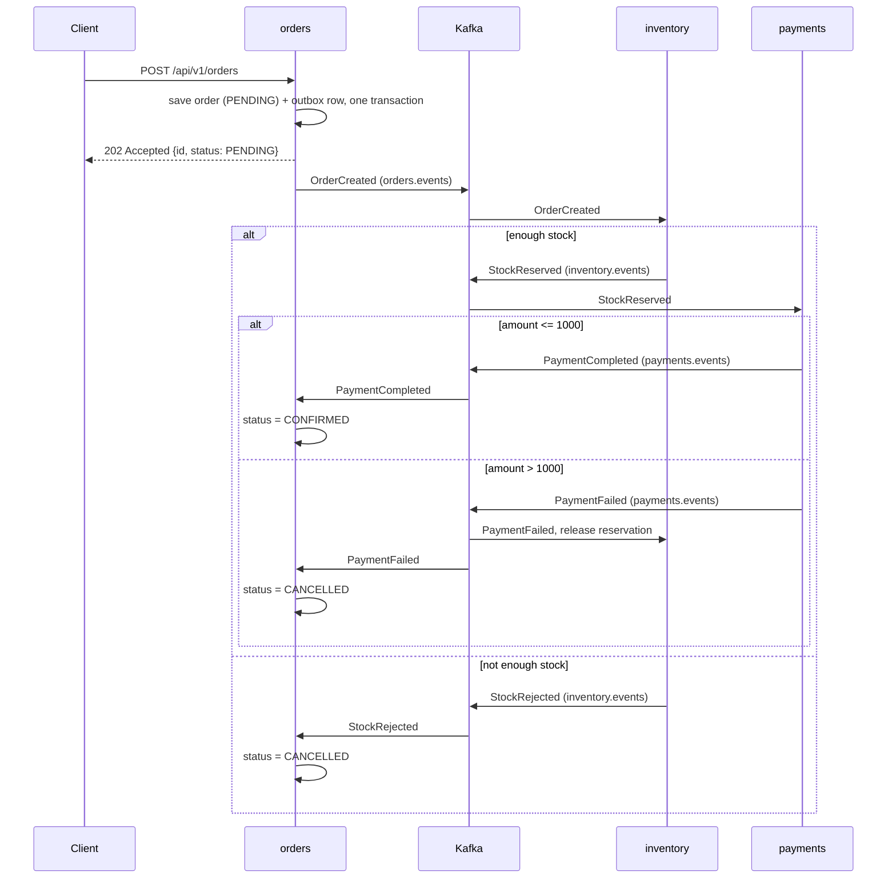

# Shop

A small event-driven order system built as three Spring Boot microservices that talk to each other through Kafka. It demonstrates a **choreographed saga** (place order → reserve stock → take payment → confirm or cancel) using the **transactional outbox** pattern for reliable publishing and an **idempotency guard** for safe, repeatable consumption.

| Service | Port | Database | Responsibility |
|---|---|---|---|
| `orders` | 8081 | `orders` | Public REST API. Creates orders and tracks their status. |
| `inventory` | 8082 | `inventory` | Reserves stock for new orders; releases it if payment fails. |
| `payments` | 8083 | `payments` | Charges (simulated) for orders whose stock was reserved. |

Each service owns its own PostgreSQL database and never reads another service's tables. All cross-service communication goes through Kafka.

## Tech stack

- Java 21, Spring Boot 4.1.1 (Maven, wrapper included)
- Spring Web MVC, Spring Data JPA, Bean Validation, Actuator
- Spring for Apache Kafka
- PostgreSQL 16 with Flyway migrations
- Kafka 3.8 (single node, KRaft mode, no ZooKeeper)
- Docker Compose for local infrastructure

## How it works



### Topics

| Topic | Published by | Consumed by |
|---|---|---|
| `orders.events` | orders | inventory |
| `inventory.events` | inventory | orders, payments |
| `payments.events` | payments | orders, inventory |

Each topic has 3 partitions and 1 replica. Messages are keyed by order id, so all events for one order stay in order. Topics are created on startup by each service.

### Reliability patterns

- **Transactional outbox.** A service never calls Kafka from inside its business transaction. It writes the event to an `outbox` table in the same transaction as the state change. `OutboxRelay` polls every 500 ms, sends unpublished rows to Kafka (waiting for the broker ack, `acks: all`), then marks them published. If Kafka is down, rows stay in the table and are retried.
- **Idempotent consumers.** Delivery is at-least-once, so duplicates are possible. Every consumer calls `IdempotencyGuard.firstTime(eventId)`, which inserts into `processed_events` with `ON CONFLICT DO NOTHING`. Because that insert is part of the handler's transaction, a duplicate is skipped and a failed handler is rolled back and retried.
- **Race-free stock reservation.** Inventory reserves with a single `UPDATE stock SET available = available - ? WHERE sku = ? AND available >= ?`, so stock can never go below zero, backed by a `CHECK (available >= 0)` constraint.
- **Compensation.** If payment fails, inventory deletes the reservation and adds the quantity back to stock.

## Prerequisites

- JDK 21
- Docker with Docker Compose
- Free ports: 5433 (Postgres), 9092 (Kafka), 8081, 8082, 8083

## Getting started

**1. Start Postgres and Kafka**

```bash
docker compose up -d
```

This starts Postgres on host port **5433** and creates the `orders`, `inventory` and `payments` databases from `init.sql`. That script only runs the first time the Postgres container is created.

**2. Start the three services** (one terminal each)

```bash
cd orders    && ./mvnw spring-boot:run
cd inventory && ./mvnw spring-boot:run
cd payments  && ./mvnw spring-boot:run
```

On Windows use `mvnw.cmd`. Flyway creates each service's tables on first start. Inventory is seeded with `BOOK-1` (10 in stock) and `PEN-1` (100 in stock).

## Try it

Place an order that should succeed:

```bash
curl -i -X POST http://localhost:8081/api/v1/orders \
  -H "Content-Type: application/json" \
  -d '{"customerId":"cust-1","sku":"BOOK-1","quantity":1,"amount":25.00}'
```

The response is `202 Accepted` with the order id and status `PENDING`. Check the result a moment later:

```bash
curl http://localhost:8081/api/v1/orders/<id>
```

| Scenario | Request | Final status |
|---|---|---|
| Happy path | `sku: BOOK-1`, `quantity: 1`, `amount: 25.00` | `CONFIRMED` |
| Out of stock | `sku: BOOK-1`, `quantity: 999`, `amount: 25.00` | `CANCELLED` |
| Payment declined | `sku: PEN-1`, `quantity: 1`, `amount: 1500.00` | `CANCELLED` (stock is released again) |

To watch the stock change, query the inventory database:

```bash
docker compose exec db psql -U postgres -d inventory -c "SELECT * FROM stock;"
```

## API

### `POST /api/v1/orders`

Creates an order and starts the saga. Returns `202 Accepted` because processing is asynchronous.

| Field | Type | Rules |
|---|---|---|
| `customerId` | string | required, not blank |
| `sku` | string | required, not blank |
| `quantity` | integer | must be positive |
| `amount` | decimal | required, must be positive |

Response: `{ "id": "<uuid>", "status": "PENDING" }`

### `GET /api/v1/orders/{id}`

Returns `{ "id": "<uuid>", "status": "..." }`, or `404` if the order does not exist.

Order statuses: `PENDING` → `CONFIRMED` or `CANCELLED`.

Actuator endpoints are also available on each service (for example `http://localhost:8081/actuator/health`).

## Project layout

```
shop/
├── docker-compose.yml     # Postgres 16 + Kafka 3.8 (KRaft)
├── init.sql               # creates the three databases
├── orders/                # REST API, order state, saga outcome handling
│   └── src/main/java/com/jlmasa/orders/
│       ├── services/      # OrderController, OrderService (+ Kafka listener)
│       ├── entities/      # Order
│       ├── repo/          # OrderRepository
│       ├── dtos/          # PlaceOrderRequest
│       └── events/        # Outbox, OutboxRelay, IdempotencyGuard, OrderEvent, Topics
├── inventory/             # InventoryHandler: reserve / release stock
└── payments/              # PaymentHandler: simulated payment
```

Each service has the same `events` package (outbox, relay, idempotency guard, event record, topics) and a `V1__messaging.sql` migration that creates the `outbox` and `processed_events` tables. The service-specific tables live in `V2__*.sql`.

## Configuration

Settings are in each service's `src/main/resources/application.yml`:

| Setting | Default |
|---|---|
| Postgres | `localhost:5433`, user `postgres`, password `postgres` |
| Kafka bootstrap servers | `localhost:9092` |
| Consumer group id | service name (`orders`, `inventory`, `payments`) |
| Consumer `auto-offset-reset` | `earliest` |
| Producer `acks` | `all` |
| Hibernate `ddl-auto` | `validate` (schema is owned by Flyway) |

## Notes and limitations

This is a learning/demo project, not production-ready as it stands.

- **Simulated payments.** `payments` approves any amount up to 1000 and declines anything above. There is no real payment provider.
- **Credentials are hard-coded** in `application.yml` and `docker-compose.yml`. Move them to environment variables or a secrets store before deploying anywhere real.
- **No authentication** on the REST API.
- **Order status stays `PENDING`** between `StockReserved` and the payment result. The orders service does not record the intermediate step.
- **Shared code is copied.** The `events` package is duplicated in each service. A shared library module would remove that duplication.
- **Outbox rows are never deleted.** Published rows accumulate in `outbox` (and ids in `processed_events`), so a cleanup job would be needed over time.
- **Single-node, single-replica Kafka** with `localhost` advertised listeners: fine for local development only.
- **Tests.** Only the default Spring Boot context-load test exists in each service, and it needs Postgres and Kafka running.

## Stopping and resetting

```bash
docker compose down        # stop infrastructure
```

Since Postgres has no volume, `down` also discards all data. The next `up` recreates the databases from `init.sql`. Clear Kafka topics the same way, since they live inside the container too.
